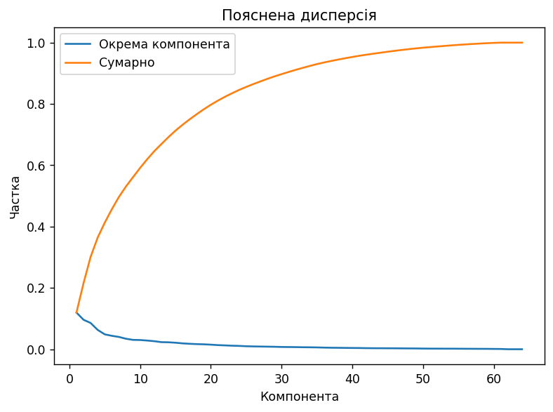
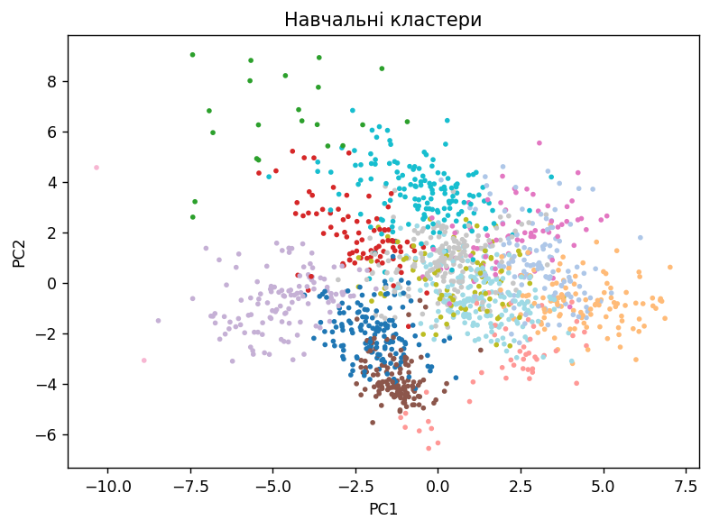
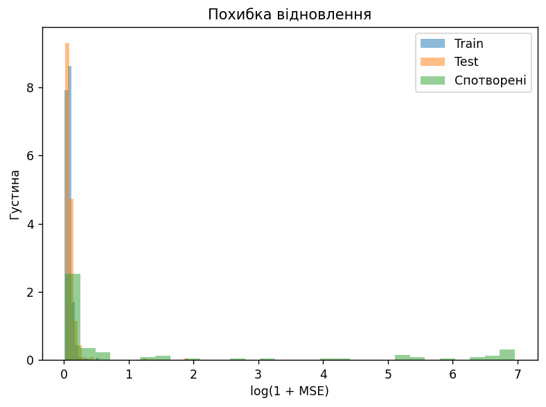

# Лабораторна робота №5. Кластеризація та пошук спотворених цифр

Лапко Максим Олексійович · ІПЗс-24-1 · №07

## Дані та протокол

Мета роботи — перевірити, як стиснення зображень впливає на поділ рукописних цифр на групи та на виявлення дефектів сканування. Використано Digits зі scikit-learn: 1797 зображень розміром 8 × 8, яскравість пікселя від 0 до 16. Стабільний ID відповідає позиції зображення у наборі. Випадковий поділ із seed 47 дав 1437 навчальних і 360 тестових записів. Категорій та пропусків немає. StandardScaler навчається на train і переводить сталі навчальні пікселі у нуль. Мітки цифр відкрито після вибору розмірності та кількості кластерів.

## Скільки компонент залишити

|Поріг дисперсії|Компоненти|Збережено|MSE відновлення|Silhouette, K=8|
|---|---:|---:|---:|---:|
|80%|21|81,09%|0,1802|0,1713|
|90%|31|90,44%|0,0911|0,1447|
|95%|40|95,33%|0,0446|0,1371|

Наперед обраний поріг 90% зменшив кількість координат із 64 до 31. Дві перші компоненти передають лише 21,57% дисперсії. Перетин груп на площині тому не дає відповіді про їх відокремленість у 31 вимірі.

## Кластери та стійкість

Для K = 4, 6, 8, 10, 12, 14 виконано по п’ять запусків у кожному просторі. Максимум середнього train silhouette в обох випадках припав на верхню межу сітки, K = 14. Silhouette зріс із 0,143 до 0,176, індекс Davies–Bouldin знизився з 1,976 до 1,689. Попарний ARI між ініціалізаціями зріс з 0,730 до 0,739. Водночас зовнішній ARI на test щодо цифр знизився з 0,650 до 0,623. Для пошуку візуальних груп обрано PCA; ототожнювати кожну з 14 груп з окремою цифрою немає підстав.

Після угорського вирівнювання для ID 327, 1204, 1305, 1440, 1337, 1003, 1086, 1068, 421 і 502 лише одна з п’яти ініціалізацій дала еталонне призначення. Це кандидати на ручний перегляд.

## Аудит аномалій

До 360 чистих тестових зображень додано 108 контрольованих копій. Для 36 копій стерто дві смуги рядків, для 36 засвічено стовпець, ще 36 зсунуто по горизонталі. Для кожного детектора поріг дорівнює 95-му перцентилю чистого train. Комбінований бал є середнім двох емпіричних train-перцентилів — Isolation Forest після PCA та похибки відновлення. Усі чотири пороги позначили по 72 навчальні записи.

|Детектор|ROC-AUC|AP|Precision|Recall|FP / FN|
|---|---:|---:|---:|---:|---:|
|Isolation Forest, 64 ознаки|0,792|0,665|0,734|0,435|17 / 61|
|Isolation Forest, PCA|0,841|0,687|0,688|0,407|20 / 64|
|Похибка відновлення|0,816|0,685|0,620|0,528|35 / 51|
|Комбінований|0,850|0,712|0,679|0,509|26 / 53|

Чистий запис 757 отримав MSE 5,769 і комбінований бал 0,999. Незвичне написання спричинило хибну тривогу. Для спотвореного запису 1203 MSE дорівнює 0,084 і бал 0,674 нижчий від порога 0,912. Стирання рядків може слабко змінити зображення, якщо вони майже порожні. Комбінований детектор знайшов усі горизонтальні зсуви, але лише 8 із 36 стертих смуг. Рекомендовано ручну перевірку верхівки рейтингу. Автоматичне видалення втратило б 26 чистих зображень.

## Відтворення

З кореня репозиторію: `python -m pip install -r lab05/requirements.txt`, `python -m lab05.main`, `python -m pytest -q lab05`. Результати за кожною ініціалізацією, метрики, пороги, приклади та матриці розбіжностей збережено у `results/`, моделі та контрольні суми — у `artifacts/`.
