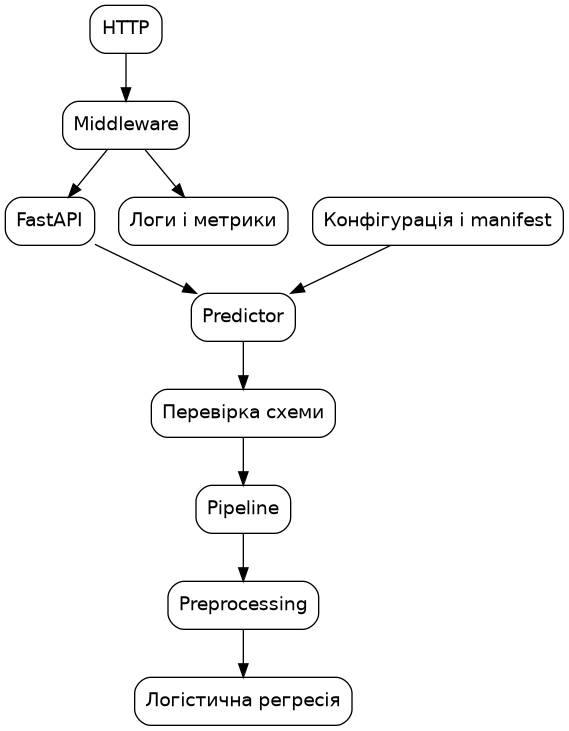

# Лабораторна робота №8. API для моделі Wine Quality

## Завдання та архітектура

Локальний REST-сервіс приймає одинадцять фізико-хімічних характеристик зразка червоного вина. Він повертає ймовірність експертної оцінки від 7 балів і клас за порогом 0,5. На старті Predictor із ЛР7 перевіряє manifest, схему та модель і один раз завантажує pipeline. Endpoint передає валідовані записи у predictor. Результат служить для навчального сортування перед дегустацією.

## Контракт і обробка відмов

|Маршрут|Виклик|Результат|
|---|---|---|
|/health, /ready|GET|Життєздатність процесу та готовність моделі|
|/metadata|GET|Версії, SHA-256, 11 ознак, сімейство, поріг і позитивний клас|
|/predict|POST, schema_version і features|Один прогноз з ID запиту|
|/predict-batch|POST, schema_version і records|До 64 прогнозів у вхідному порядку|
|/metrics|GET|Лічильники статусів, warnings, середня затримка і перцентилі|

Відсутні або зайві поля, текст замість числа, NaN, нескінченність та неправильна версія повертають 422. Якщо модель недоступна, readiness і прогноз повертають 503, а health відповідає 200. Внутрішня помилка повертає 500 зі стабільним кодом. За request ID можна зіставити відповідь із технічним журналом. Лічильник виходів за навчальні межі є простим сигналом зміни вхідних даних.

## Вимірювання й висновок

Після 10 прогрівів виконано 120 одиничних запитів, 40 пакетів по 16 і 48 запитів при конкуренції 4. Вимірювався повний HTTP-виклик через loopback до запущеного Uvicorn. Для single p50/p95/p99 склали 3,10/4,77/6,59 мс, для batch — 3,41/5,84/8,16 мс. Пакетна пропускна здатність сягнула 4019 записів/с. Усі 208 запитів успішні. 18 тестів API перевірили маршрути, версію, помилки і граничні розміри. Результати залежать від машини та профілю трафіку. In-memory метрики обмежені одним процесом, довгостроковий моніторинг і роботу за зовнішньою мережею слід перевірити окремо.

## Відтворення

З кореня встановити пакет і залежності: `python -m pip install ./lab07 -r lab08/requirements.txt`. Запуск: `python -m uvicorn lab08.app:app --host 127.0.0.1 --port 8000`. Контракт доступний у /docs і openapi.json. Тести: `python -m pytest -q lab08`. Відтворення HTTP-бенчмарку та експорт OpenAPI: `python -m pip install -r lab05/requirements.txt`, `python -m practical08.checks`. Для відтворення використано ізольоване Python-середовище та сервер Uvicorn.
