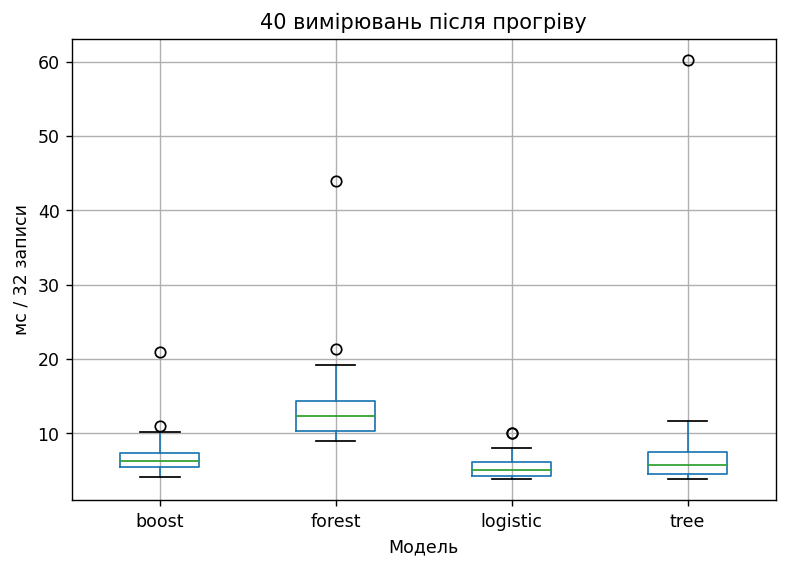
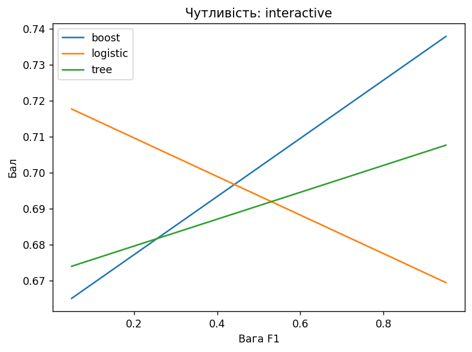

# Практична робота №5. Вибір моделі за інженерними обмеженнями

Лапко Максим Олексійович · ІПЗс-24-1 · №07

## Постановка задачі

Для навчального архіву Titanic порівняно модель швидкої інтерактивної відповіді та модель пакетного аналізу. Одна одиниця спостереження — пасажир. Позитивний клас AtRisk означає, що пасажир не вижив. Пропущений позитивний випадок занижує оцінку історичних втрат. Висновки стосуються ретроспективного дослідження 891 запису.

## Протокол і вимоги

712 пасажирів використано для навчання, 179 відкладено. П’ять спільних стратифікованих folds, поріг 0,5. На кожному fold імпутація, масштабування та one-hot кодування навчаються всередині pipeline. Профіль знято для пакета з 32 записів після п’яти прогрівів за 40 повторів в одному потоці. Розмір включає preprocessing та модель у стисненому joblib.

Інтерактивний сценарій допускає p95 до 100 мс, розмір до 60 000 байтів і recall від 0,77. В архівному сценарії ліміти становлять 100 мс, 1 000 000 байтів і recall від 0,78. Це задані навчальні вимоги. Орієнтири корисності обрано до запуску: F1 0,70–0,92, recall 0,70–0,95, затримка 15–1 мс та розмір 400 000–3000 байтів. Поза ними корисність обмежено інтервалом [0, 1]. За рівності балів діє алфавітний порядок ідентифікаторів.

|Модель|CV F1|CV recall|p95, мс|Байти|
|---|---:|---:|---:|---:|
|Логістична регресія|0,847|0,875|8,14|2147|
|Дерево|0,856|0,907|10,45|2797|
|Випадковий ліс|0,863|0,918|19,25|116 888|
|Градієнтний бустинг|0,863|0,907|10,25|21 558|

## Вибір і чутливість

В інтерактивному сценарії ліс перевищив ліміт розміру. Ваги F1, recall, затримки та розміру становлять 0,20 / 0,15 / 0,35 / 0,30. Логістична регресія отримала 0,710, резервне дерево — 0,680. В архівному сценарії всі моделі допустимі. За ваг 0,45 / 0,44 / 0,06 / 0,05 переміг бустинг із балом 0,765, резервне дерево отримало 0,752.

Окремо змінено вагу F1 від 0,05 до 0,95, пропорційно перераховуючи решту. В інтерактивному сценарії регресія перемогла у 8 із 19 точок, бустинг — в 11, перша зміна відбулася при 0,45. Для архіву дерево виграло лише при 0,05, в інших 18 точках переміг бустинг.

## Фінальна перевірка

Обидва рішення збережено до відкриття test. Логістична регресія дала F1 0,847 і recall 0,855; бустинг — F1 0,868 і recall 0,900. Обидва F1 потрапили в описовий діапазон CV «середнє ± одне стандартне відхилення». Апаратно залежні час навчання, затримка та пропускна здатність. Зміна машини, розподілу ознак або мінімального recall вимагає повторного вибору. Стратифікований поділ за пасажирами не перевіряє узагальнення на інше судно.

## Відтворення

З кореня: `python -m pip install -r practical05/requirements.txt`, `python -m practical05.main`, `python -m pytest -q practical05`. Один сценарій запускається аргументом `--config practical05/configs/interactive.json`. Таблиці містять усі folds, виміри, нормалізовані складові та причини відхилень. При повторі рейтинг може змінитися через виміряну затримку.
